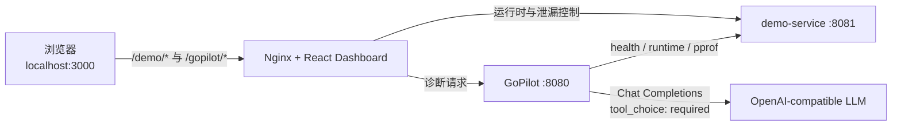

# GoPilot

GoPilot 是一个面向 Go Runtime 的证据驱动智能诊断演示。它通过真实的运行时指标和 pprof 数据，让 Agent 按“观察 → 调用工具 → 核验证据 → 提交诊断”的受控流程定位 Goroutine 泄漏，而不是直接猜测根因。

当前竞赛演示聚焦一个完整场景：注入可控的 Goroutine 泄漏，观察数量趋势，运行 AI 调查，查看带证据引用的结构化诊断，最后重置并确认服务恢复。

## 评委快速体验

- [3 分钟评委使用指南](docs/judge-guide.md)：无 API Key 也能完成故障注入、指标观察和真实历史诊断回放。
- [技术架构文档](docs/architecture.md)：组件职责、Agent Tool Calling、Evidence Grounding 与安全边界。
- [系统总体架构图](docs/diagrams/system-architecture.svg)：适合 GitHub 浏览、比赛答辩与演示讲解。

## 核心能力

- 可重复、数量有界且可重置的 Goroutine 泄漏演示
- 1 秒级真实 Go Runtime 指标采样与有界历史窗口
- 解析并聚合真实 `/debug/pprof/goroutine?debug=2` 堆栈
- 有最大步数限制的 OpenAI-compatible Tool Calling Agent
- 服务端拥有的调查时间线和 observation_id 证据校验
- 无需 API Key 的真实 DeepSeek 历史诊断回放
- 专业中文诊断控制台，包含趋势、调查过程、根因与证据
- 三服务 Docker Compose 一键部署，浏览器仅访问同源入口

## 架构



只有 Web 服务映射到宿主机 `127.0.0.1:3000`。`demo-service` 和 `gopilot` 仅在 Compose 网络内可达；原始 pprof 也不会由生产 Nginx 暴露。LLM 凭据只注入 GoPilot 容器，不进入浏览器、前端构建参数或 demo-service。

## 使用 Docker Compose 启动

要求：Docker Desktop（或 Docker Engine）以及 Docker Compose v2。

无需 LLM 即可运行监控、注入和重置流程：

```bash
docker compose up -d --build
docker compose ps
```

打开 <http://localhost:3000>。

如需 AI 诊断，先从示例创建本地配置并填写有效凭据：

```powershell
Copy-Item .env.example .env
```

DeepSeek 示例：

```ini
LLM_BASE_URL=https://api.deepseek.com
LLM_API_KEY=your-api-key
LLM_MODEL=deepseek-flash
LLM_THINKING=disabled
```

GoPilot 始终保持 `tool_choice: required`。DeepSeek 的 thinking 模式不支持该设置，因此必须显式使用 `LLM_THINKING=disabled`。其他 OpenAI-compatible 提供商若不支持 `thinking` 扩展，应让 `LLM_THINKING` 保持为空。

常用运维命令：

```bash
docker compose logs -f
docker compose restart
docker compose down
```

Compose 会自动读取仓库根目录的 `.env`，该文件已被 Git 忽略。请勿提交真实 API Key。

## 无 API Key 体验方式

不创建 `.env`，或让 `LLM_BASE_URL`、`LLM_API_KEY`、`LLM_MODEL` 保持为空，然后正常启动：

```bash
docker compose up -d --build
```

打开 Dashboard 后仍可完整体验实时 Runtime 采样、健康基线、注入 25 个泄漏和重置。进入“AI 智能诊断”区域时有两个明确模式：

- **实时 AI 诊断**：调用 DeepSeek 分析当前运行时，需要有效 API Key；未配置时会明确显示 `agent_not_configured`。
- **查看历史诊断**：从 `/replays/goroutine-leak.json` 读取此前真实 DeepSeek 调用形成的完整记录，不访问模型服务，也不需要 API Key。

历史回放包含原始调查顺序、Tool 参数、服务器生成的 observation_id、真实 Metrics 和 pprof 分组、根因及建议。页面会持续把它标记为“历史真实诊断回放”；历史指标不会覆盖当前 Runtime，历史 observation 也不会进入当前 Agent Ledger。当前服务的 Inject 或 Reset 操作不会修改静态案例。

案例来源、录制过程、校验结果和文件摘要见 [docs/replay-provenance.md](docs/replay-provenance.md)。若希望运行自己的实时诊断，请按上一节配置 DeepSeek 凭据并重建或重新创建 `gopilot` 容器。

## 竞赛演示流程

1. 打开 Dashboard，等待“服务在线”和观测基线建立。
2. 点击“注入泄漏”，创建 25 个可控 Goroutine。
3. 观察 Goroutine 数量和趋势相对健康基线上升。
4. 点击“开始诊断”，等待 Agent 完成真实工具调用。
5. 展开诊断过程与证据，确认 `get_service_status`、`get_runtime_metrics`、`get_goroutine_profile` 的 observation_id 与最终引用一致。
6. 确认根因指向 `LeakController.waitForever`，再点击“重置演示”。
7. 等待活动泄漏回到 0、Goroutine 数量恢复并重新建立可信基线。

无 API Key 的现场演示可在第 4 步改为点击“查看历史诊断”。此时上方仍显示当前服务的实时数据，下方明确展示过去独立调查的时间线和证据。

完整讲解词见 [docs/demo-script.md](docs/demo-script.md)。

## 同源开发与调试接口

生产环境和 Vite 开发环境均使用相同前缀：

- `GET /demo/healthz`
- `GET /demo/api/runtime`
- `POST /demo/api/leak`，请求体 `{"count":25}`
- `POST /demo/api/leak/reset`
- `GET /gopilot/healthz`
- `GET /gopilot/api/tools/service-status`
- `GET /gopilot/api/tools/runtime-metrics?window_seconds=30`
- `GET /gopilot/api/tools/goroutine-profile?top_n=10`
- `POST /gopilot/api/diagnoses`

例如，在 Compose 启动后可以通过唯一公开入口检查状态：

```bash
curl http://localhost:3000/demo/healthz
curl http://localhost:3000/gopilot/healthz
```

## 本机开发

要求 Go 1.23+、Node.js 22+ 和 npm。

```powershell
go run ./cmd/demo-service
```

另一个终端：

```powershell
$env:DEMO_SERVICE_URL = "http://localhost:8081"
go run ./cmd/gopilot
```

再启动前端：

```powershell
Set-Location web
npm ci
npm run dev
```

Vite 会把 `/demo/*` 和 `/gopilot/*` 分别代理到本机的 8081 与 8080 端口。

## 配置

| 变量 | 用途 | 默认/说明 |
| --- | --- | --- |
| `DEMO_SERVICE_URL` | GoPilot 唯一允许采集的目标 | 本机默认为 `http://localhost:8081`；Compose 固定为 `http://demo-service:8081` |
| `GOPILOT_ADDR` | GoPilot 监听地址 | `:8080` |
| `DEMO_ADDR` | demo-service 监听地址 | `:8081` |
| `LLM_BASE_URL` | OpenAI-compatible API 基地址 | 为空时不启用 Agent |
| `LLM_API_KEY` | 提供商凭据 | 仅进入 GoPilot 运行容器 |
| `LLM_MODEL` | 支持 Tool Calling 的模型名 | 为空时不启用 Agent |
| `LLM_THINKING` | 可选的 `enabled` / `disabled` 扩展 | 不配置时不发送 `thinking` 字段 |

未配置 Agent 时，监控、泄漏控制和证据采集仍可用；`POST /gopilot/api/diagnoses` 会明确返回 `agent_not_configured`，不会生成伪诊断。

## 验证

```bash
go vet ./...
go test ./...
go test -race ./...
cd web
npm test
npm run build
```

部署配置与运行态验证：

```bash
docker compose config
docker compose build
docker compose up -d
docker compose ps
docker compose logs --no-color
```

## 技术亮点

- 原始观测和 observation_id 由服务端创建并保管，模型只能引用，不能自行声明不存在的证据。
- LLM 推断与运行时观测分离：GoPilot 执行工具、规范化结果并记录账本，模型只负责基于这些结果形成判断。
- 每次调查都有独立范围；`submit_diagnosis` 会验证所有 evidence_ref 都属于当前调查，否则拒绝结果。
- 指标历史、pprof 输入、工具参数和 Agent 步数均有界，避免一次异常调查无上限消耗资源。
- `submit_diagnosis` 是唯一允许完成诊断的路径，调查时间线由服务端账本生成，不由模型或前端伪造。
- 健康检查只表达服务进程在线；运行时异常由真实指标和证据单独呈现。
- 健康基线只从无活动泄漏的可信采样建立，避免把故障状态误认为正常。

## 常见问题排查

- 容器未变为 `healthy`：运行 `docker compose ps` 和 `docker compose logs --no-color`，先确认 Docker Engine 正常、镜像仓库可访问。
- 构建阶段无法连接 Docker Hub：这是基础镜像拉取问题；恢复网络或配置本机 Docker 镜像加速后，重新执行 `docker compose up -d --build`，无需改动项目镜像地址。
- 端口 3000 被占用：停止占用该端口的本地进程，或临时修改 `compose.yaml` 中 Web 的宿主机端口映射。
- 页面显示 Agent 未配置：确认 `.env` 中 `LLM_BASE_URL`、`LLM_API_KEY` 和 `LLM_MODEL` 已填写，然后执行 `docker compose up -d --force-recreate gopilot`。
- DeepSeek 返回 thinking/tool_choice 冲突：设置 `LLM_THINKING=disabled`；不要把 `tool_choice` 改为 `auto`。
- 监控可用但诊断失败：查看 `docker compose logs gopilot` 中的提供商状态码与协议错误。日志不会主动输出 API Key。
- 修改前端后页面仍是旧版本：重新执行 `docker compose build web && docker compose up -d web`，然后刷新浏览器缓存。

## 当前限制

- 当前演示仅覆盖单个 Go 服务的 Goroutine 泄漏场景。
- 指标和调查数据存于进程内存，容器重启后不会持久化。
- Agent 使用非流式诊断协议，页面在完整结果返回后展示调查时间线。
- 历史回放是一个经过校验的静态真实案例，不是调查数据库，也不会随当前服务状态更新。
- 不包含身份认证、租户隔离或公网生产安全加固；宿主机端口默认只绑定本地回环地址。
