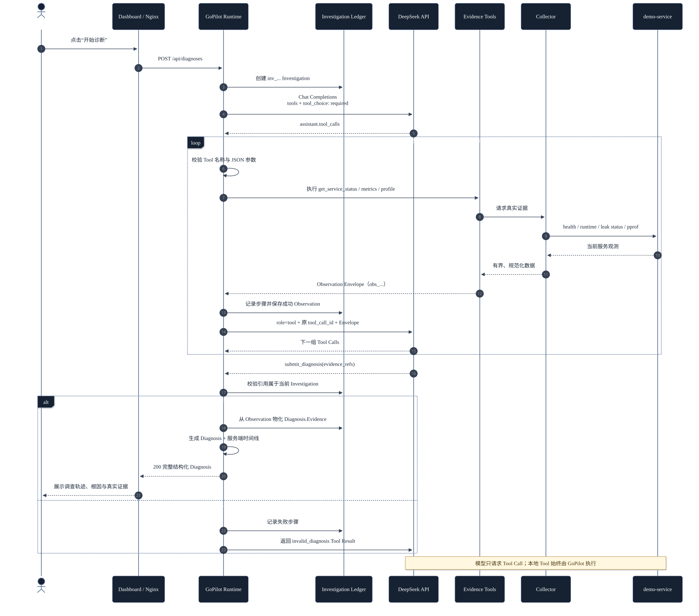

# GoPilot v1.1 技术架构

## 1. 系统定位与功能边界

GoPilot v1.1 是一个证据驱动的 Go Runtime 智能诊断 MVP。当前只实现一个完整场景：对单个 demo-service 注入受控 Goroutine 泄漏，采集 Runtime 与 pprof 证据，让有步数上限的 Agent 通过 Tool Calling 调查，并返回带服务端证据引用的结构化诊断。

它不是通用 APM、生产级多租户平台或自动修复系统。当前没有数据库、用户认证、分布式追踪、持续告警、跨服务拓扑、RAG、MCP、Kubernetes 或 eBPF。

## 2. 技术栈

| 层次 | 实际技术 |
| --- | --- |
| demo-service | Go 1.23、标准库 `net/http`、`runtime`、`net/http/pprof` |
| GoPilot 后端 | Go 1.23、标准库 HTTP Client/Server、进程内采样环形缓冲区 |
| Agent | OpenAI-compatible Chat Completions、Function/Tool Calling、`tool_choice: required` |
| Dashboard | React 19、TypeScript 7、Vite 8 |
| Web 入口 | `nginx-unprivileged`，静态资源与同源反向代理 |
| 部署 | 三服务 Docker Compose；Go/Node 多阶段构建、Alpine 运行镜像 |

## 3. 系统组件职责

### Web / Nginx

- 唯一映射到宿主机的服务：`127.0.0.1:3000 -> web:8080`。
- 提供 React Dashboard 和静态历史回放 JSON。
- 将 `/demo/*` 代理到 demo-service，将 `/gopilot/*` 代理到 GoPilot。
- 显式拒绝公开 `/demo/debug/pprof/*`；原始 pprof 只允许 GoPilot 在 Compose 网络内采集。

### demo-service

- 提供 `/healthz`、`/api/runtime`、`/api/leak/status`、`/api/leak`、`/api/leak/reset`。
- 注册标准 `net/http/pprof` 端点。
- `LeakController` 单次最多注入 100 个、总活动数量最多 500 个 Goroutine。
- 泄漏 Goroutine 阻塞在可识别的 `LeakController.waitForever`；Reset 关闭 generation channel 并等待它们退出。

### GoPilot Backend

- 目标 URL 由服务端 `DEMO_SERVICE_URL` 配置，浏览器不能提交任意目标地址。
- Collector 每秒采样一次 `/api/runtime`，最多保留 300 条进程内历史记录。
- Evidence Tools 规范化服务状态、时间窗口指标和 pprof 分组。
- Agent Runtime 管理模型消息、Tool 执行、Investigation Ledger、证据校验和最终 Diagnosis。
- 未配置 `LLM_BASE_URL` 与 `LLM_MODEL` 时仍提供健康检查和 Evidence Tools，但诊断端点返回 `agent_not_configured`。

### DeepSeek / OpenAI-compatible Provider

- 只接收 GoPilot 发送的消息、Tool Schema 和 Tool Result。
- 不直接调用 demo-service，也不能执行 GoPilot 本地函数。
- 只能通过 Tool Call 请求 GoPilot 执行证据工具。

## 4. Docker Compose 服务拓扑

Compose 定义 `demo-service`、`gopilot`、`web` 三个服务。demo-service 与 gopilot 仅通过 `expose` 在 Compose 网络内开放端口；web 是唯一宿主机入口。GoPilot 固定采集 `http://demo-service:8081`，LLM 配置由 Compose 显式注入 GoPilot。

## 5. HTTP/API 请求路径

### 浏览器可访问的同源路径

| 方法与路径 | Nginx 上游 | 用途 |
| --- | --- | --- |
| `GET /demo/healthz` | demo-service `/healthz` | 当前服务存活状态 |
| `GET /demo/api/runtime` | demo-service `/api/runtime` | 当前 Runtime 快照 |
| `GET /demo/api/leak/status` | demo-service `/api/leak/status` | 活动受控泄漏数量 |
| `POST /demo/api/leak` | demo-service `/api/leak` | 注入受控泄漏，Dashboard 固定发送 25 |
| `POST /demo/api/leak/reset` | demo-service `/api/leak/reset` | 终止当前 generation 的演示泄漏 |
| `GET /gopilot/healthz` | GoPilot `/healthz` | GoPilot 存活状态 |
| `GET /gopilot/api/tools/service-status` | GoPilot Tool API | 手工检查服务状态证据 |
| `GET /gopilot/api/tools/runtime-metrics?window_seconds=30` | GoPilot Tool API | 手工检查窗口指标证据 |
| `GET /gopilot/api/tools/goroutine-profile?top_n=10` | GoPilot Tool API | 手工检查有界 pprof 分组 |
| `POST /gopilot/api/diagnoses` | GoPilot Agent API | 非流式实时诊断 |
| `GET /replays/goroutine-leak.json` | Web 静态文件 | 无 Key 历史真实诊断回放 |

Nginx 对 `/demo/debug/pprof/*` 返回 404。GoPilot 通过内部地址直接读取 `/debug/pprof/goroutine?debug=2`。

## 6. Runtime 指标与 pprof 采集

### Runtime Sampler

- 默认间隔：1 秒。
- 默认容量：300 条；使用固定大小环形缓冲区，避免无界内存增长。
- 每条样本包含采集时间、Go 版本、Goroutine 数、堆分配字节数、堆对象数和 uptime。
- 临时失败记录为结构化 `CollectionError`；查询窗口会携带采集状态。
- `get_runtime_metrics` 接受 5–120 秒窗口，返回起止值、最小值、最大值、绝对增量、近似增长率、堆变化和历史不足状态。

### Goroutine Profile

- Collector 对原始 pprof 响应设置 2 MiB 上限。
- Parser 按 Goroutine state 与规范化函数帧生成栈签名并聚合相同堆栈。
- 每组最多保留 32 个函数帧，Tool 只返回前 1–20 个分组，并提供截断元数据。
- `LeakController.waitForever` 会被标记为可识别的 intentional leak frame。
- 原始无界 profile 不会存入指标历史，也不会原样转发给模型。

## 7. Agent Runtime 设计

Runner 为每次请求创建独立 Investigation，默认最多执行 8 个模型步骤。每一步调用 OpenAI-compatible `/chat/completions`，并始终发送 `tool_choice: "required"`。合法响应必须包含唯一 Tool Call ID 的 Function Calls；空 Tool Call、重复 ID、非法参数或不支持的 Tool 都会产生明确失败。

支持的工具：

| Tool | 输入 | 数据来源 |
| --- | --- | --- |
| `get_service_status` | `{}` | demo-service health、runtime、leak status |
| `get_runtime_metrics` | `{"window_seconds": 5..120}` | Sampler 中的真实历史样本 |
| `get_goroutine_profile` | `{"top_n": 1..20}` | 实时 pprof goroutine profile |
| `submit_diagnosis` | 结构化诊断与 `evidence_refs` | 只负责提交；不采集新证据 |

模型返回多个 Tool Calls 时，GoPilot 按返回顺序逐个执行。Tool Result 再以 `role: tool` 和原 `tool_call_id` 返回模型。最终只允许通过 `submit_diagnosis` 完成调查。

## 8. Tool Calling 流程

1. Dashboard 提交中文诊断问题。
2. GoPilot 创建 `inv_...` Investigation，加入 system/user messages。
3. DeepSeek 选择一个或多个证据工具。
4. GoPilot 校验 JSON 参数，并在本地执行对应 Tool。
5. Tool 通过 Collector 获取真实服务数据，生成 Observation Envelope。
6. 成功 Observation 存入当前 Investigation Ledger，并作为 Tool Result 返回模型。
7. 模型可以继续取证，或调用 `submit_diagnosis`。
8. GoPilot 校验提交字段与 `evidence_refs`，由服务端物化最终 Evidence 和 Investigation Timeline。
9. 非流式 HTTP 响应一次性返回完整 Diagnosis。

模型不是 Tool 执行主体；它只能提出调用请求。网络访问、参数校验、目标选择和数据规范化都由 GoPilot 控制。

## 9. Investigation Ledger

Ledger 是单次 Agent Run 内的进程内结构，包含：

- `investigation_id`、开始时间、状态和失败 Tool 数；
- 有序 `InvestigationStep`：sequence、agent_step、tool_call_id、Tool、规范化参数、状态、Observation ID/错误、起止时间；
- 仅当前 Investigation 可访问的成功 Observation map 与顺序；
- 最终 Diagnosis。

最终 `Diagnosis.Investigation` 是 Ledger 的服务端副本，不由模型生成。当前 Ledger 不持久化，进程退出后消失。

## 10. Evidence Grounding 机制

每个 Tool 结果使用统一 Envelope：`ok`、GoPilot 生成的 `observation_id`、`tool`、`captured_at`、`data` 或结构化 `error`。成功 Observation 才会进入 Ledger。

模型在 `submit_diagnosis.evidence_refs` 中只能提供 Observation ID。服务端逐个验证：

1. 引用非空且不重复；
2. ID 存在于当前 Investigation；
3. Observation 执行成功；
4. 至少引用一条证据；
5. confidence 位于 0–1，其他诊断字段非空。

任何未知或跨 Investigation 的引用都会被拒绝，并作为失败 Tool Result 返回模型修正。验证通过后，GoPilot 从 Ledger 读取原始 Observation，生成 `Diagnosis.Evidence`；模型不能自行填充 Evidence 数据。

这保证的是“结论所引用的观测确实存在且来自本次调查”，并不保证模型推断必然正确。因此 UI 明确将 confidence 标注为模型估计。

## 11. 历史真实诊断回放

静态案例位于 `web/public/replays/goroutine-leak.json`，来源和校验详情见[回放来源说明](replay-provenance.md)。它保存一次真实 DeepSeek 调查的 Diagnosis、6 个时间线步骤和 5 条 Evidence。

前端读取后会校验 Schema、时间线连续性、Observation 唯一性、Tool/Evidence 对应关系、最后一步 `submit_diagnosis`，以及 `evidence_refs` 与物化 Evidence 集合的一致性。校验失败则拒绝展示。

回放不调用 GoPilot Diagnosis API，不访问 DeepSeek，不写当前 Ledger，也不覆盖当前 Runtime 状态。它是随 Web 镜像发布的只读历史快照，不是持久化调查系统。

## 12. 数据边界与密钥安全

- 浏览器只能使用同源 `/demo`、`/gopilot` 与静态 replay 路径。
- GoPilot 目标由 `DEMO_SERVICE_URL` 固定配置，浏览器不能传入任意 URL。
- 原始 pprof 不经 Nginx 对外暴露；模型只看到有界、结构化的分组结果。
- `.env` 已被 Git 忽略；Compose 只把 LLM 变量注入 GoPilot。
- API Key 不进入前端构建参数、demo-service、Evidence、Replay 或正常日志。
- Tool 参数、响应体、历史容量、profile 大小和 Agent 步数都有边界。
- 当前没有认证机制，因此宿主机端口只绑定 `127.0.0.1`，不应直接改为公网监听。

## 13. 当前技术限制

- 仅诊断一个预配置 demo-service 和一个 Goroutine 泄漏场景。
- Runtime 历史与 Investigation 都只保存在内存中。
- 诊断为非流式请求，前端不会展示伪造的实时 Tool 进度。
- 没有 Provider 重试编排、持久化审计库、身份认证或权限模型。
- 历史回放只有一个经过验证的静态案例。
- health 只表达进程存活；异常判断仍依赖 Metrics、leak status 与 pprof。

## 14. 后续可扩展方向（未实现）

以下内容仅为演进方向，**当前代码没有实现**：

- 持久化 Investigation/Evidence，并支持多个经过签名或版本化的回放案例；
- 增加受控的 mutex contention、CPU hotspot 等演示场景；
- 为多个预注册服务提供只读目标目录与访问策略；
- 增加用户认证、审计、速率限制和 Provider 成本预算；
- 在不破坏 Grounding 的前提下提供真实服务端事件流；
- 构建可重复的诊断质量评测集与 Provider 兼容性测试矩阵。

上述方向不应被解读为 v1.1 已具备的能力。
